<!-- animated contribution graph: real data, cells pop in one by one
     (regenerated daily by .github/workflows/update-profile-art.yml) -->

<h3><code>burgy@github ~ $ ./contributions.sh</code></h3>

 
 

<!-- ascii portrait (left) + streak/numbers card (right), both 840x880.
     portrait: built from the GitHub avatar; commit your own source-photo.png
     and run the workflow with "regenerate_portrait" ticked to change it. -->

<h3><code>burgy@github ~ $ whoami</code></h3>

<table>
<tr>
<td valign="top"></td>
<td valign="top"></td>
</tr>
</table>

<b>French Web Developer & Entrepreneur · Web & airsoft for 5+ years</b>

 

<h3><code>burgy@github ~ $ ls ./companies</code></h3>

<table>
<tr>
<td align="center" width="50%">
<b>🎯 Airsoft Corp</b> 
Airsoft events, scenarios & second-hand gear  

</td>
<td align="center" width="50%">
<b>🚀 Made Forward</b> 
No Legend Alone · Print Craft Studio · Weelyt  

</td>
</tr>
<tr>
<td align="center">
<b>🖨️ Print Craft Studio</b> 
Custom printing for clothing & goodies  

</td>
<td align="center">
<b>👕 No Legend Alone</b> 
Streetwear brand  

</td>
</tr>
<tr>
<td align="center">
<b>🔁 Airsoft Occasions</b> 
Second-hand airsoft marketplace  

</td>
<td align="center">
<b>🗺️ Airsoft Explorer</b> 
Interactive map of French airsoft fields  

</td>
</tr>
</table>

 

<h3><code>burgy@github ~ $ ./links.sh</code></h3>

 

<h3><code>burgy@github ~ $ cat stack.txt</code></h3>

               

